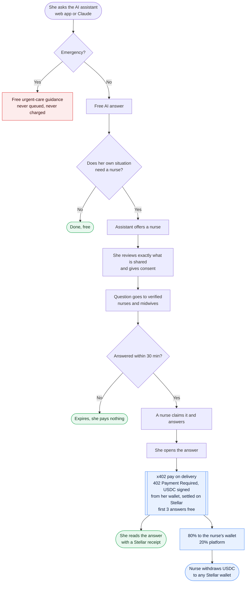

# CareLayer

CareLayer is an open network of verified, registered Nigerian nurses and midwives that any AI health agent can call and pay per answer.

- Women ask an AI assistant for free.
- When a question needs a professional, the assistant sends it to a verified health worker, but only with her consent.
- The answer is paid for with x402 agentic payments in USDC on Stellar, and the health worker gets their share straight away.
- Any agent can use the network: our web app, Claude through our MCP server, or other apps.

Built for the EmpowerHer: Building the Agent Economy hackathon.

## Live

| What                         | Link                                                                                                             |
| ---------------------------- | ---------------------------------------------------------------------------------------------------------------- |
| Women's app and landing page | [www.carelayer.health](https://www.carelayer.health)                                                             |
| Health worker app            | [practice.carelayer.health](https://practice.carelayer.health)                                                   |
| API                          | [api.carelayer.health](https://api.carelayer.health/health) (`/health` returns `{ "status": "ok" }`)             |
| Admin console (licences)     | [api.carelayer.health/admin-console](https://api.carelayer.health/admin-console) (admins only, see below)        |
| MCP server for Claude        | `https://mcp.carelayer.health/mcp` (setup: [`apps/mcp/README.md`](apps/mcp/README.md))                           |
| API docs (Postman)           | [documenter.getpostman.com/view/44554019/2sBYPv3YMs](https://documenter.getpostman.com/view/44554019/2sBYPv3YMs) |

Everything runs on **test money**:

- Top-ups use Paystack test mode. Use a Paystack test card, not a real one.
- USDC payments are on the Stellar **testnet**. Every transaction can be checked on [stellar.expert (testnet)](https://stellar.expert/explorer/testnet).

**Admin console:** only existing admin accounts can sign in. Anyone can open the page, but:

- Sign-in uses a code emailed to an admin address.
- Admin accounts can't be created by signing up (the API refuses with 403). They are only created by the server's seed step.
- Every `/admin/*` request checks for the admin role, so a woman's or nurse's account gets 403.

## Built on x402 and Stellar

### x402: agents pay per answer

The nurse's answer is a paid resource behind **x402**. `GET /questions/:id/answer` returns `402 Payment Required` with the price in USDC. The agent signs a Stellar payment, retries with `PAYMENT-SIGNATURE`, and gets the answer with a `PAYMENT-RESPONSE` receipt.

- **Official x402 packages:** `@x402/core`, `@x402/stellar`, `@x402/fetch` and `@x402/express`. Network `stellar:testnet`, settled through the OpenZeppelin Channels facilitator, which pays the fees.
- **Pay on delivery:** no answer, no 402. An unanswered question returns `409` before any payment is asked for, and an expired one costs nothing.
- **Settle before reveal:** the payment is verified, recorded and settled **before** the answer text is read. A failed payment never leaks the answer.
- **Never charged twice:**
  - Opening the answer again returns the same receipt.
  - If the facilitator times out, the payment is looked up on chain before she is asked to pay again.
- **Agents pay, not people:**
  - In our web app and in Claude (through our MCP server), the payment is made by an agent from her custodial Stellar wallet. She only says yes.
  - The paying side is the standard x402 client (`createPayingFetch` in `x402-client.ts`). Any agent with a Stellar keypair can pay this way.
- **Agent guardrails:**
  - Claude gets a revocable agent token that works on only 5 routes.
  - Claude has its own spending limit.
  - "Ask before each payment" is on by default.
- **Code:** [`apps/api/src/modules/payments/`](apps/api/src/modules/payments/) (`answer-x402.ts`, `x402.ts`, `x402-client.ts`). The first proof payment on testnet: [b2ce5681…](https://stellar.expert/explorer/testnet/tx/b2ce568136e4372c5b5faa5ab963ebeac8ad94afaa661bb2ccbf2f6b09ef30ed).

### Stellar: wallets, USDC and payouts

- **A Stellar wallet for every user, with no crypto knowledge needed:**
  - Every woman and nurse gets a Stellar account when they sign up.
  - The platform treasury **sponsors its reserves**, so the account holds 0 XLM.
  - The account gets a **USDC trustline** in the same transaction.
  - Secret keys are encrypted at rest (AES-256-GCM) and never leave the server.
- **Naira in, USDC on chain:** she tops up in naira with Paystack, and the same value lands in her wallet as testnet USDC.
- **The chain is the source of truth:** balances are read live from Stellar, and every payment, payout, top-up and withdrawal links to its transaction on stellar.expert.
- **Instant 80/20 split:**
  - When she pays, 80% goes to the nurse's wallet in a treasury payment straight after settlement.
  - 20% stays with the platform.
  - Her first 3 free answers are paid to the nurse by the treasury, so nurses always earn.
- **Withdraw to any Stellar wallet:**
  - Nurses send USDC to any Stellar address, with a memo for exchanges.
  - The platform pays the fee with a **fee-bump transaction**.
  - The destination is checked first: the account must exist and trust USDC.
  - Every withdrawal needs an emailed code.

## How it works



### For women ([www.carelayer.health](https://www.carelayer.health))

1. **Sign in** with an emailed code (no password). A custodial Stellar wallet is created for her automatically. She never needs XLM or a crypto wallet of her own.
2. **Chat with the assistant.** AI answers are free. Every message is checked for emergencies first (a fixed red-flag list plus the LLM). An emergency gets clear urgent-care guidance and is never charged or queued.
3. **The nurse offer.** General questions are just answered. When her own situation needs a professional to judge, the assistant offers a nurse and says why in one sentence. She can also ask a nurse directly at any time.
4. **Send to a nurse (3 steps):**
   - **What's shared:** exactly what the nurse will see. She can edit the question and remove the assistant's notes. Never her name, email, phone or location.
   - **Who answers:** the first available nurse, or a chosen one. There is an "Only female health workers" option.
   - **Confirm:** the price, or free for her first 3 answers. Nothing is charged until an answer arrives. She can ask to be emailed when it is answered (the email holds no health details).
5. **Waiting.** If no nurse answers within 30 minutes (up to 40 if one is mid-answer), the question expires and she pays nothing.
6. **Her answer.** Paid on delivery over x402 from her wallet. She sees the nurse's name and verified role, a "see someone today" note if the nurse ticked it, and the Stellar receipt. She can rate it helpful or not. The answer also appears in the chat she asked from.
7. **Top up** in naira with Paystack (test mode). The same value arrives in her wallet as USDC.
8. **Safety:**
   - Quick exit on every screen.
   - Her chats and questions are listed in History. She can delete a chat.
   - Nurses never see who she is.

### For health workers ([practice.carelayer.health](https://practice.carelayer.health))

1. **Sign up** with their licence details. An admin approves the licence in the admin console before they can answer.
2. **Answer:**
   - The queue shows the questions they can take.
   - Claiming one locks it for 10 minutes.
   - They answer and can tick "Recommend she sees someone today".
3. **Earn and withdraw:**
   - 80% of each answer goes to their wallet as USDC.
   - They withdraw to any Stellar address. Sending money out needs an emailed code.

### For other agents (Claude)

The MCP server gives Claude three tools: `ask_health_worker`, `get_answer` and `get_balance`. The woman connects Claude from **Account → Use CareLayer in Claude** in the app. Claude then follows the same rules as the app:

- Consent first.
- Her own spending limit.
- It asks before each payment, unless she turns that off.

Setup: [`apps/mcp/README.md`](apps/mcp/README.md).

## Setup (local)

Requirements: Node.js 22.12+ (24 recommended, see `.nvmrc`), npm 10+, Docker.

```bash
git clone https://github.com/zainabwahab-eth/CareLayer.git carelayer && cd carelayer
npm install                      # installs every workspace and builds packages/shared
docker compose up -d postgres    # Postgres on localhost:5432 (user/pass/db: carelayer)

# Copy each env example (never commit the copies)
cp apps/api/.env.example apps/api/.env
cp apps/mcp/.env.example apps/mcp/.env
cp apps/web/.env.example apps/web/.env.local
cp apps/workers/.env.example apps/workers/.env.local

npm run db:migrate -w @carelayer/api   # apply migrations
npm run db:seed -w @carelayer/api      # demo data (Tolu, three midwives, a pending nurse, an admin)
npm run dev
```

| App                   | URL                          | Check                                                            |
| --------------------- | ---------------------------- | ---------------------------------------------------------------- |
| API                   | http://localhost:4000/health | `{ "status": "ok", "database": "ok" }` (503 if Postgres is down) |
| Women's app + landing | http://localhost:5173        | The CareLayer landing page                                       |
| Health worker app     | http://localhost:5174        | "CareLayer for Health Workers"                                   |
| MCP server            | `npm run dev:mcp` (stdio)    | `npm run inspect -w @carelayer/mcp`                              |

Sign-in codes are printed in the API's console locally. The seeded accounts are listed in [`apps/api/README.md`](apps/api/README.md#seed-data).

Other root scripts: `npm run build`, `npm run lint`, `npm run typecheck`, `npm test`, `npm run format`.

Deploying the API (Google Cloud Run + Neon): see "Deploy" in [`apps/api/README.md`](apps/api/README.md).

## Repository layout

```
apps/web        Landing page + women's app (React, Vite, PWA)
apps/workers    Health worker app (React, Vite, PWA)
apps/api        Backend (Express, Prisma, PostgreSQL, x402, Stellar)
apps/mcp        MCP server for Claude
packages/tokens Design tokens (tokens.css)
packages/shared Shared types and API contract types
docs/           Brief, API contract, task guide, Postman collection
```

## Docs

- [Project brief](docs/PROJECT_BRIEF.md)
- [API contract (v1)](docs/API_CONTRACT.md)
- [API docs on Postman](https://documenter.getpostman.com/view/44554019/2sBYPv3YMs) (collection and environments also in [`docs/postman/`](docs/postman/))
- [Task guide](docs/TASKS.md)
- [CLAUDE.md](CLAUDE.md): rules for AI coding agents working in this repo
